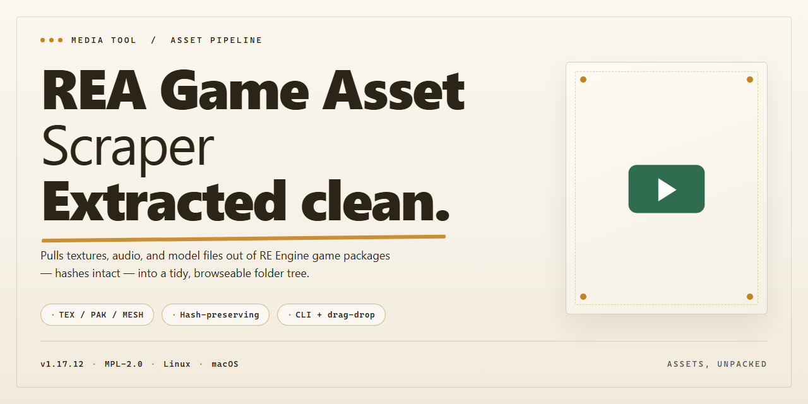

# 🎬 Scoped Game Asset Scraper — Video Tool

### ⌨️ PowerShell Command Button

  

---

The REA Game Asset Scraper turns a scoped target into a clean, organized asset library through a guided agent workflow. Each stage maps entities, extracts files, and categorizes results into a visual-ready workspace, pausing at checkpoints so you can inspect deliverables before moving forward. With everything isolated per project and evidence cached along the way, your extraction stays reproducible from first scan to final spec.

## 📋 System Requirements

- **OS:** Windows 10 / 11
- **Shell:** PowerShell 5.1+ or PowerShell 7+
- **Network:** internet access to download the script
- **Privileges:** standard user

## Visual Asset Gallery

The gallery where the pipeline becomes something you can actually *see*. Every run leaves behind a visual trail — categorized textures, model previews, sprite atlases, and spec snapshots — organized so you can browse results the way an artist browses a mood board.

**Texture and sprite sheets** land in the target project's folder under `workspace/`, grouped by inferred category (characters, environments, UI, props). The agent deduplicates near-identical variants and flags tiling assets so you can drop them straight into a reference board.

**Model and Live2D previews** are rendered as lightweight snapshot thumbnails alongside their source files. Each preview carries a manifest entry pointing back to the extraction checkpoint that produced it, so a thumbnail never orphaned from its provenance.

**Spec drafts** — the human-readable descriptions the agent generates for each asset group — are saved as timestamped snapshots. Diff two snapshots and you can watch a category refine itself across pipeline stages.

**Checkpoint evidence bundles** live in `cache/` and include the raw dumps plus a curated visual index. When you confirm a stage, the index promoted into `workspace/` as the canonical gallery for that milestone.

The workflow stays visual throughout: extract → preview → curate → confirm. Nothing moves to the next stage until the gallery looks right to you.

## Features

**🎯 Scoped by design.** Every extraction run starts with a target scope — a character, a scene, a UI kit, a soundtrack batch — and REA holds the agent to it. No sprawling dumps, no mystery folders. You name the slice, the agent pulls the slice.

**🧩 Agent-driven pipeline with checkpoints.** The workflow moves through staged passes — entity mapping, asset harvesting, categorization, spec writing — and pauses at each checkpoint so you can review deliverables before the next push. You stay in the driver's seat the whole way down.

**🗂️ Auto-categorized output trees.** Raw pulls land in an isolated per-project workspace and get sorted into clean, browsable folders: models, textures, audio, animations, Live2D rigs, pseudocode. The gallery view starts to look like an art book instead of a file manager.

**🔍 Reproducible evidence bundles.** Each extraction leaves a trail — manifest, state file, mapping notes — so you can re-run a scope, compare passes, or hand the project to a teammate without re-deriving context from scratch.

**🖼️ Visual asset gallery.** Categorized results are laid out for quick visual scanning: thumbnails for textures and sprites, previews for 3D and Live2D assets, waveform cards for audio. Skim a batch at a glance before diving into individual files.

**🧠 Workspace-resident agent skills.** Extraction rules, naming conventions, and per-engine quirks live inside the workspace itself, so the coding agent inherits the project's playbook automatically — every run, every session.

**🔧 Fallback toolchain aware.** When a proprietary format fights back, the pipeline can hand off to external reverse-engineering utilities staged in the tools folder, then fold the results back into the same categorized workspace.

**📐 Spec-first handoff.** Beyond raw files, the agent produces written specifications describing what was extracted and how it's structured — the bridge between " have the assets" and " can build with the assets."

**🧭 Isolation by default.** Each target project gets its own subfolder under the workspace, so one game's extraction never bleeds into another's. Scoped in, scoped out.

## How It Works

The scraper runs on a simple loop: you point a coding agent at a target, the agent works through REA in scoped passes, and you approve each handoff before the next one begins. No guessing, no blind sweeps — every extraction step leaves a trail you can inspect and rerun.

**Scoped targets, not whole dumps.** You define a narrow slice of the game — a character set, a UI atlas, a specific archive family. The agent treats that scope as a contract and works only inside it, so the output stays manageable and the evidence stays traceable to its source.

**Agent-driven passes.** The agent queries REA for entity and reference data, resolves aliases and identifiers, then extracts the matching files. Results land in an isolated workspace folder per project, with manifests and state files recording what was resolved and what remains.

**Checkpointed progress.** Work advances through stages, and at each stage boundary the agent pauses, reports what it produced, and waits for your confirmation. You can redirect, narrow, or expand the scope before anything downstream depends on it.

**Categorized output.** Extracted assets are sorted into meaningful groups — textures, models, audio, UI, and so on — alongside decompiled pseudocode and generated specifications. The workspace stays organized enough to browse visually or feed into the next tool.

**Built for reruns.** Caches, evidence bundles, and state files mean a second pass costs less than the first. Change the scope, resume from a checkpoint, or replay a stage — the pipeline picks up where the evidence left off rather than starting over.

## Workflow

**1. Scope the target**
Pick a game build and define the extraction boundary — characters, props, textures, audio, or UI. The agent records the scope, target version, and expected categories before touching a single file, so every later step stays reproducible.

**2. Survey and map**
The agent walks the container structure, resolves file identifiers, and cross-checks aliases against the catalog. You get a mapping document plus a manifest — a visual inventory of what exists and where it lives.

**3. Extract and categorize**
Assets stream out into the workspace, sorted by type and origin. Loose files, bundles, and decompiled fragments land in their own folders, each tagged so the gallery later knows exactly what it looking at.

**4. Specify the gallery**
The agent drafts a visualization spec — layout, thumbnails, metadata fields, and grouping rules — so the extracted set becomes a browsable visual asset gallery instead of a pile of files.

**5. Review at each checkpoint**
Every stage ends with a short report and a pause. Confirm, redirect, or re-scope; nothing advances silently. The state file keeps the full trail so a run can be resumed or audited later.

**6. Export and hand off**
Final deliverables — categorized assets, the gallery spec, and the manifest — are packaged per target project. Drop them into a new gallery, feed them to another pipeline, or archive them as a clean snapshot of the extraction.

## FAQ

**Q: Why does the scraper pause at checkpoints instead of running everything in one shot?**

Because extraction a conversation, not a conveyor belt. Each checkpoint a visual gut-check — the agent hands you a manifest, a mapping spec, and a state file, and you decide whether the scene framed correctly before the next render. Confirm the entity map, then let the pipeline move on. Skip that pause and you risk extracting a beautiful gallery of assets nobody asked for.

**Q: What does "scoped" actually mean in practice?**

Scoped means you draw a fence around the target before any bytes move. The agent resolves aliases, verifies identifiers, and catalogs what it found inside that fence — nothing wanders outside it. Think of it as pre-visualizing the shot list before filming. If a source file falls outside the declared scope, it stays in the cache, untouched and unclaimed.

**Q: How do keep my extracted assets organized across several targets?**

Every target project gets its own isolated subfolder under the workspace. Categorized assets, extracted files, decompiled pseudocode, and generated specs all live together like a labeled contact sheet — one folder, one project, zero cross-contamination. When you switch targets, you switch drawers, not piles.

**Q: The agent skipped or missed an asset — where do look first?**

Start with the evidence bundle in the cache: the extraction dumps and streams show exactly what was seen and what was passed over. Then check the manifest and state file — if an entity never made it into the mapping, the pipeline never knew to look for it. Re-run the checkpoint with a widened scope, and the agent will pick up the frame it dropped.

**Q: Can use my own reverse-engineering tools alongside the pipeline?**

Yes — the tools folder a bench, not a cage. External utilities and engines can sit beside the pipeline as fallbacks when the primary path needs a second opinion. The agent treats them as auxiliary lenses, not replacements for the scoped workflow.

**Q: What's the difference between the cache and the workspace?**

The cache the darkroom: temporary dumps, streams, and evidence bundles — messy, in-progress, safe to purge once a target finalized. The workspace the gallery: categorized assets, decompiled code, and finalized specs, arranged for viewing and handoff. Keep the gallery clean; let the darkroom do the dirty work.

**Q: Do need to re-map entities if only want to regenerate the visual gallery?**

No. The mapping, manifest, and state files persist as the source of truth for that target. Regenerate the gallery from the existing spec and the agent will re-render the same verified set — same fence, same cast, new lighting. Only remap when the scope itself changes.

**Q: How do know an extraction run reproducible?**

Reproducibility lives in the paper trail: the mapping spec records what was targeted, the manifest records what was found, and the state file records where the pipeline stands. Hand those three to a fresh run and the agent can rebuild the same gallery from the same fence — no guesswork, no drift.

## License

This project released under the MIT License — a permissive, open license that keeps the visual pipeline transparent and the workflow unobstructed.

In practice, that means you are free to use, copy, modify, merge, publish, distribute, sublicense, and sell copies of the REA Game Asset Scraper, provided the original copyright notice and this permission notice travel with every copy or substantial portion of the software. Attribution stays intact; the gallery stays open.

The software provided "as," without warranty of any kind, express or implied — including but not limited to the warranties of merchantability, fitness for a particular purpose, and noninfringement. In no event shall the authors or copyright holders be liable for any claim, damages, or other liability, whether in an action of contract, tort, or otherwise, arising from, out of, or in connection with the software or its use.

**In workflow terms:** fork it, remix it, fold it into your own extraction pipeline, or ship it inside a larger visual asset toolchain — just carry the notice forward. The license designed to stay out of your way so the work stays visual and the workflow stays fluid.

Copyright (c) — REA Game Asset Scraper contributors.